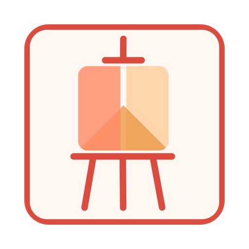
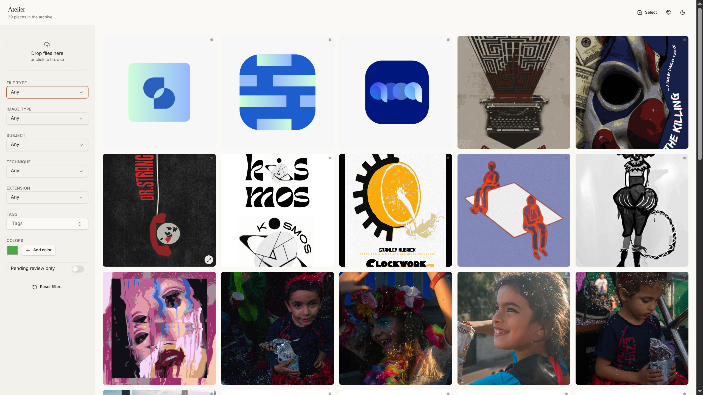
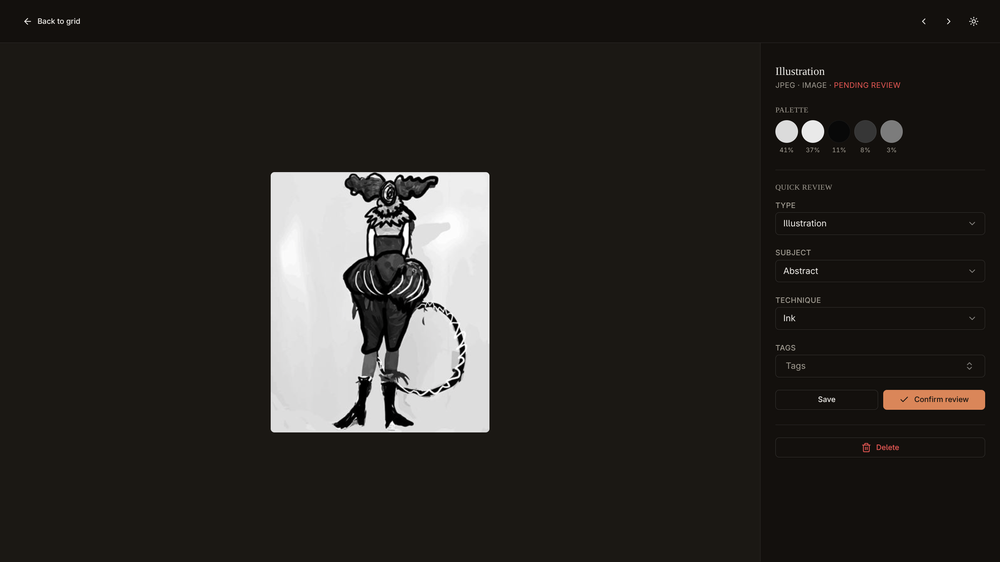
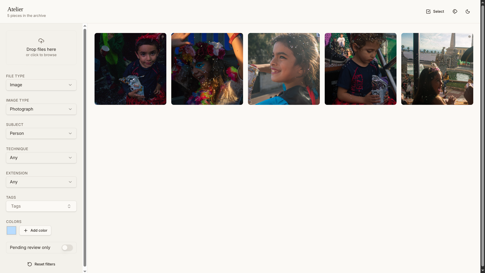
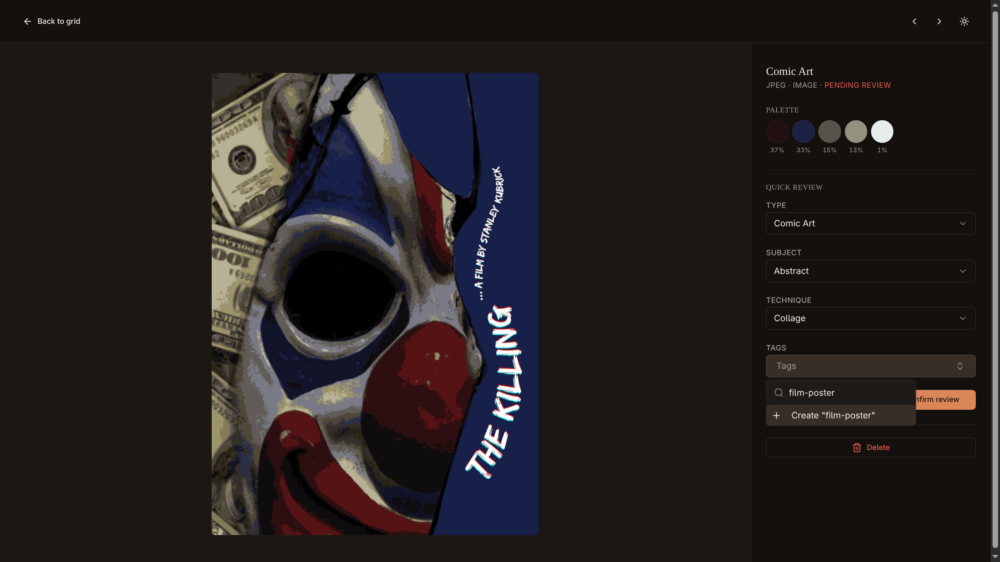
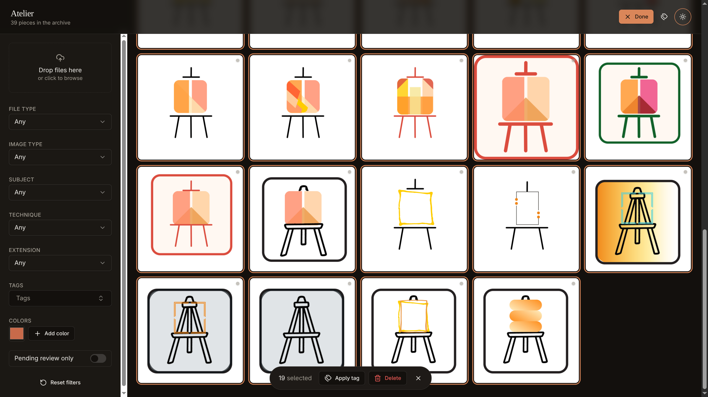
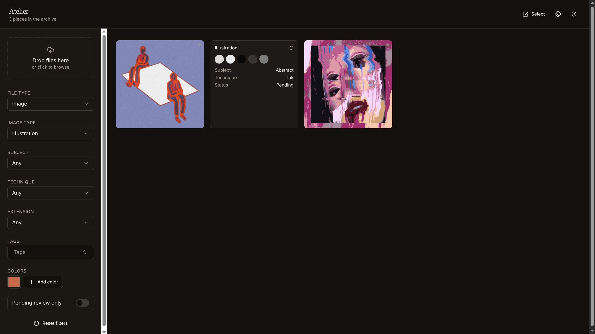
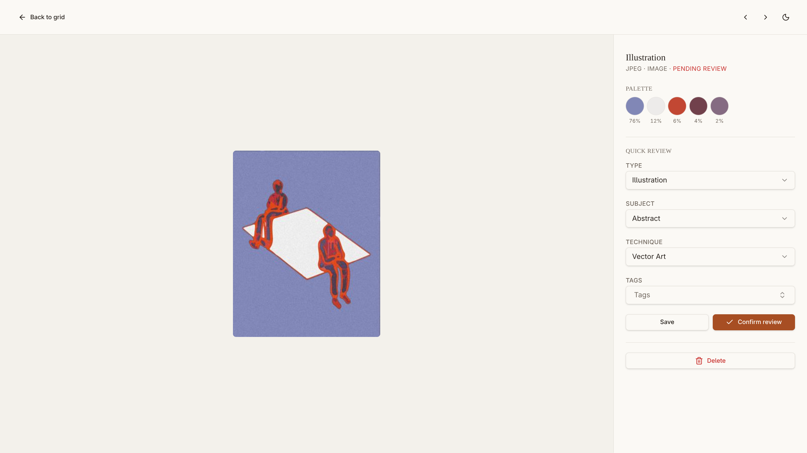

<div align="center">


# Atelier

**Your art collection, understood.**<br>
A gallery that classifies, tags and organizes your artwork automatically.

[Quick start](#quick-start) · [NAS](INSTALLATION_GUIDE.md) · [Docs](docs/ARCHITECTURE.md)

<br>

</div>
<br>

## Why Atelier

Digital art collections grow messy fast: thousands of files, no consistent names, no way to find "that blue-ish watercolor landscape". Atelier looks at every piece and does the filing for you, so you can spend your time on the work, not on folders.

## What it does

|                              |                                                                         |
| ---------------------------- | ----------------------------------------------------------------------- |
| **Classifies automatically** | Detects type (painting, illustration, photo…), subject and technique.   |
| **Understands color**        | Extracts each palette so you can filter your whole collection by color. |
| **Organizes in bulk**        | Batch tagging and editing across hundreds of pieces at once.            |
| **Runs everywhere**          | Web, plus native desktop apps for Windows, macOS and Linux.             |
| **Looks the part**           | Clean interface with light and dark themes.                             |

<br>
<table>
  <tr>
    <td width="33%"></td>
    <td width="33%"></td>
    <td width="33%"></td>
  </tr>
  <tr>
    <td align="center"><sub>Review and classify</sub></td>
    <td align="center"><sub>Classify Photographs</sub></td>
    <td align="center"><sub>Create tags on the fly</sub></td>
  </tr>
  <tr>
    <td width="33%"></td>
    <td width="33%"></td>
    <td width="33%"></td>
  </tr>
  <tr>
    <td align="center"><sub>Bulk actions and filter by color</sub></td>
    <td align="center"><sub>Flip a card for details</sub></td>
    <td align="center"><sub>Light mode</sub></td>
  </tr>
</table>
<br>

## Quick start

```bash
git clone <https://github.com/Tomasmoralessp/atelier.git>
cd atelier
docker-compose up -d
```

Then open **http://localhost:3000** (API docs at http://localhost:8000/docs).

Running on a NAS? See the [installation guide](INSTALLATION_GUIDE.md).

## Built with

FastAPI · PostgreSQL · React 19 · TypeScript · Tailwind CSS · Tauri · Docker

See [docs/ARCHITECTURE.md](docs/ARCHITECTURE.md) for how the pieces fit together.

## Contributing

Contributions are welcome. Fork the repo, create a feature branch and open a pull request with a short description of the change.

## License

[MIT](LICENSE)

<br>
<div align="center">
<sub>Made with ❤️ for artists and curators.</sub>

</div>
